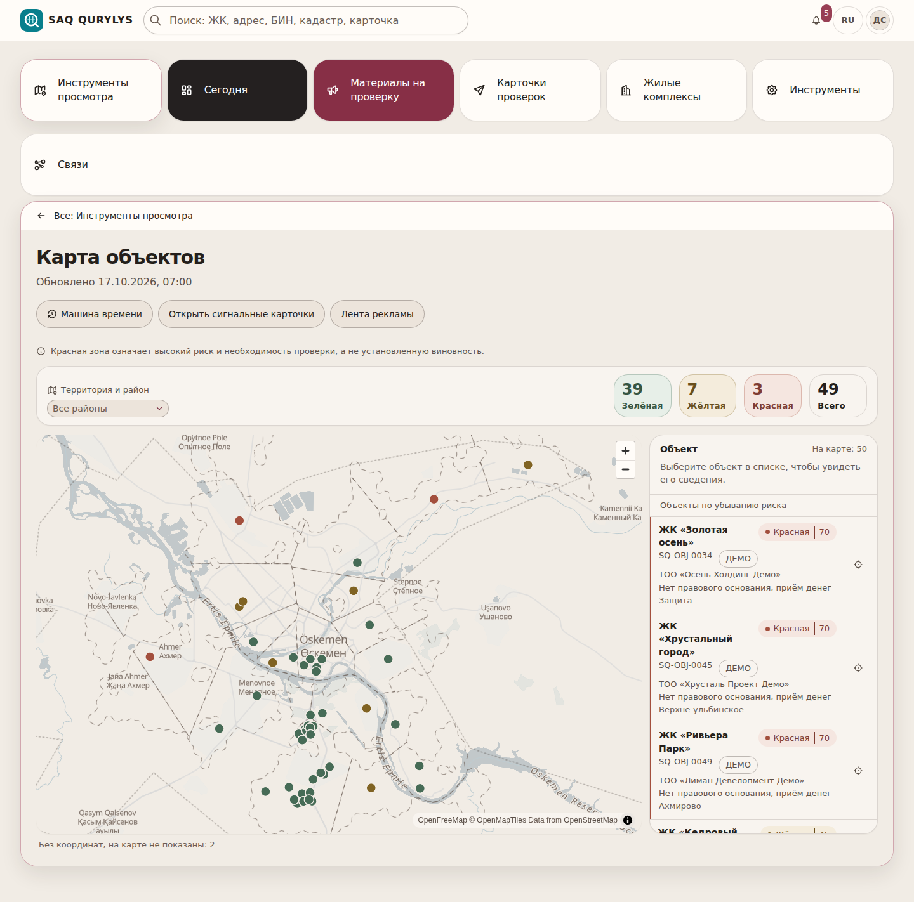
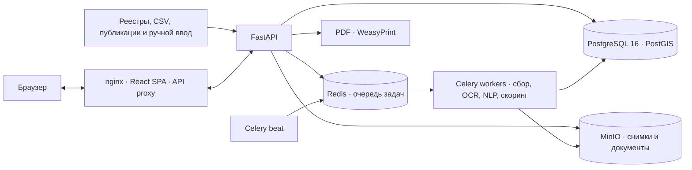

<div align="center">
  
  <h1>SAQ QURYLYS</h1>
  <p><strong>Мониторинг рисков в долевом жилищном строительстве</strong></p>
  <p>Объекты, публикации, доказательства и решения аналитика — в одном рабочем процессе.</p>
  <p>Кейс Codemasters Hackathon 8.0 · Усть-Каменогорск · 2026</p>
  <p><a href="#быстрый-старт">Быстрый старт</a> · <a href="#возможности">Возможности</a> · <a href="#архитектура">Архитектура</a> · <a href="#структура-проекта">Структура проекта</a></p>
</div>

> **Риск — это приоритет проверки, а не вывод о нарушении.** Система сохраняет основания и показывает, из чего сложилась оценка. Решение по сигналу принимает человек; автоматической отправки материалов в госорганы нет.

<p align="center">
  
</p>

## Быстрый старт

Нужны Docker Engine или Docker Desktop с активным Docker daemon, Docker Compose v2 с поддержкой `up --wait` и Bash. Из корня репозитория выполните одну команду:

```bash
./scripts/start-demo.sh
```

Скрипт создаст `.env` из `.env.example`, только если файла ещё нет, соберёт и запустит сервисы, дождётся их готовности и загрузит демонстрационные данные в пустую базу. Существующий `.env` скрипт не перезаписывает; при повторном запуске база и пароли учётных записей сохраняются. После запуска откройте [http://localhost:8080](http://localhost:8080).

При первом заполнении пустой базы seed выведет логины и пароли новых демо-пользователей один раз — сохраните их. Пароль задаётся переменной `DEMO_USER_PASSWORD` в `.env`; если она пустая, seed создаст случайные пароли и покажет их в выводе. Учётка администратора использует `INITIAL_ADMIN_USERNAME` и `INITIAL_ADMIN_PASSWORD` из `.env`. При повторном запуске существующие учётные записи не пересоздаются, а их пароли повторно не выводятся. Демо-объекты и публикации вымышлены.

Для первого знакомства войдите как `demo_mio`, откройте объект «Золотая осень», проверьте связанные публикации и основания, затем изучите расшифровку факторов и черновик сигнальной карточки.

Базовый демо-стенд не требует GPU, LLM или токенов внешних сервисов. Если запуск остановился из-за занятого порта, освободите порты `8080`, `8000`, `5433`, `6379`, `9000` и `9001`, затем повторите команду. Логи API и фонового обработчика: `docker compose logs -f api worker`.

## Возможности

| Раздел | Что можно делать |
|---|---|
| **Обзор и карта** | Смотреть объекты на карте, фильтровать по району и зоне риска, искать по ЖК, адресу, кадастровому номеру или застройщику. |
| **Карточка ЖК** | Сверять застройщика, документы, правовое основание, стадию строительства, обращения, связанные телефоны и аккаунты. |
| **Мониторинг публикаций** | Добавлять объявление вручную или фиксировать страницу: сохраняются PNG-снимок, MHTML-архив, время и SHA-256. Изменение или удаление публикации не стирает уже зафиксированную версию. |
| **Объяснимый риск** | Видеть балл, факторы R1–R6 и связанные с ними доказательства. Неизвестные и непроверенные сведения показаны отдельно и сами по себе балл не повышают. |
| **Сигнальная карточка** | Проверять черновик, возвращать его на доработку или подтверждать и направлять по маршруту. Система формирует PDF и сохраняет журнал действий. |
| **Работа команды** | Использовать ролевой доступ с территориальными границами, поручения, общую ленту событий, граф связей и отчёты. Интерфейс доступен на русском и казахском языках. |

Дополнительно доступен **SAQ VISION** для разбора фото и видео с фиксацией находок. Сервис и модели включаются отдельно; результаты модели служат подсказками и требуют проверки специалистом. Подробности — в [архитектуре SAQ VISION](docs/SAQ_VISION_ARCHITECTURE.md).

## Как считается риск

Балл равен сумме весов подтверждённых факторов R1–R6 и ограничен 100. Гипотеза модели или автоматически собранная публикация не влияет на оценку, пока аналитик не подтвердит данные и их связь с объектом.

| Зона | Правило |
|---|---|
| Зелёная | 0–24 балла |
| Жёлтая | 25–59 баллов; также 60+ без одновременного подтверждения R1 и R2 |
| Красная | 60+ баллов и одновременно подтверждены R1 и R2; создаётся черновик сигнальной карточки |

Формула и условия каждого фактора описаны в [спецификации](docs/SPEC.md). Неустановленное основание не считается отсутствующим: неизвестность попадает в список «Нужна проверка».

## Архитектура



Backend — модульное приложение на FastAPI. Фоновые задачи выполняются через Celery и Redis; PostgreSQL с PostGIS хранит реестр и рабочие данные, MinIO — файлы доказательств. Архивные записи содержат хэш и время фиксации; важные журналы защищены от изменения на уровне базы данных.

## Структура проекта

```text
.
├── backend/
│   ├── app/
│   │   ├── modules/       # объекты, публикации, риск, сигналы и другие домены
│   │   ├── collectors/    # сборщики публикаций
│   │   ├── worker/        # фоновые задачи и расписание
│   │   ├── bot/           # Telegram-бот для обращений
│   │   └── seed_data/     # демонстрационные данные
│   └── tests/
├── frontend/
│   ├── src/               # интерфейс, страницы, функции и API-клиент
│   ├── e2e/               # сценарии браузерной проверки
│   └── public/            # статические файлы и знак проекта
├── docs/                  # спецификация, разработка, данные и архитектура
├── scripts/               # запуск демо и утилиты проекта
├── docker-compose.yml
└── README.md
```

## Технологии

| Часть | Стек |
|---|---|
| Frontend | React 19, TypeScript, Vite, Tailwind CSS, MapLibre GL |
| Backend | Python 3.12, FastAPI, SQLAlchemy, Alembic |
| Данные и файлы | PostgreSQL 16, PostGIS, MinIO |
| Фоновые задачи | Celery, Redis, Celery beat |
| Обработка | Playwright, Tesseract OCR, pymorphy3, rapidfuzz, WeasyPrint |
| Локальная разработка | Docker Compose |

## Проверки и разработка

Запуск демо проверяет готовность сервисов и загружает фикстуры. Чтобы сверить три контрольных сценария кейса с работающим API после обработки очереди, выполните:

```bash
python3 scripts/verify_case_scenarios.py
```

Для разработки backend-тесты и статические проверки запускаются из `backend/`, frontend-проверки — из `frontend/`:

```bash
# backend
uv sync
uv run pytest
uv run ruff check .
uv run mypy app tests

# frontend
pnpm install --frozen-lockfile
pnpm typecheck
pnpm lint
pnpm build
```

Подготовка окружения, настройки безопасности и локальная работа описаны в [руководстве разработчика](docs/DEVELOPMENT.md).

## Данные и ограничения

- Демонстрационные ЖК, пользователи и публикации вымышлены; в seed-наборе нет персональных данных граждан.
- Автоматический сбор публикаций, синхронизация с реестром АО «КЖК», LLM-помощник и SAQ VISION выключены по умолчанию. Для дополнительных сервисов нужны отдельные настройки; базовый запуск от них не зависит.
- У разрешений МИО, кадастра и e-Otinish нет используемого системой публичного API: результаты такой проверки вносятся специалистом вручную с доказательством.
- Сборщики OLX и Krisha могут получать блокировку площадок; Instagram подключается только через официальный Graph API. Текущие ограничения источников собраны в [справочнике данных](docs/DATA_SOURCES.md) и [открытых вопросах](docs/OPEN_QUESTIONS.md).

Дополнительные материалы: [руководство по помощнику](docs/ASSISTANT.md), [пользовательские сценарии](docs/UX_WORKFLOWS.md), [правила интерфейса](docs/UI.md) и [сторонние компоненты](THIRD_PARTY_NOTICES.md).
